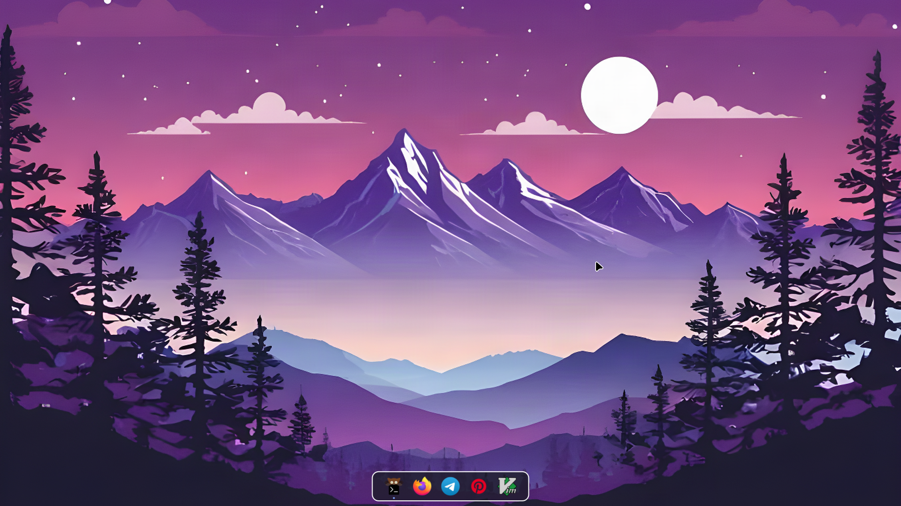

# Hyprdock

A minimal, customizable app dock for [Hyprland](https://hypr.land), built with [Quickshell](https://quickshell.org).
Everything is configured in a small built-in settings window. No config files to edit by hand.

<!-- Add a screenshot: put it in docs/screenshot.png and uncomment the next line -->
<!--  -->

## Features

- **Apps and websites** in one dock. A website opens in the browser you choose.
- **Settings window** with sliders and switches, changes apply instantly:
  - corner roundness (0% sharp, 100% fully rounded)
  - size (small but readable, up to about a tenth of the screen height)
  - spacing between icons
  - background opacity (0% invisible, 100% solid)
  - border: `dark` (black) or `light` (white)
  - behavior with open windows: always visible, or hide and show on hover at the bottom center of the screen
- **Hover zoom** with a spring animation, name tooltip, a dot under running apps.
- **Reorder icons** in settings, and they smoothly slide to their new places in the dock.
- Left click focuses a running app (or starts it), middle click starts a new instance, right click opens settings.
- One dock per monitor. Font: JetBrains Mono.

## Requirements

| Package | Why |
|---------|-----|
| Hyprland | the compositor |
| Quickshell | draws the dock |
| JetBrains Mono | the font |

## Install

```sh
git clone https://github.com/egorka402/hyprdock.git
cd hyprdock
./install.sh
hyprdock
```

Full instructions, including Gentoo: [INSTALL.md](INSTALL.md).

## Usage

```sh
hyprdock            # start the dock
hyprdock settings   # open settings (or right-click any icon)
hyprdock restart    # restart the dock
hyprdock stop       # stop the dock
```

Start it with Hyprland by adding this to `hyprland.lua`:

```lua
hl.exec_cmd("hyprdock")
```

(or `exec-once = hyprdock` in the old `hyprland.conf` format).

Settings are stored in `~/.config/hyprdock/config.json`. See [config.example.json](config.example.json).

## Adding items

1. Open settings, press **+ add**.
2. **App:** pick it from the list (or type a custom command such as `kitty -e btop`).
3. **Website:** paste the link and choose a browser.
4. Optionally change the name and icon (a theme icon name or a path to an image), then press **add to dock**.

## Known limitations (v0.1)

- Only the bottom edge is supported.
- Running-app detection needs the window class to match the app; some apps may not show the dot.
- Items cannot be reordered by dragging yet (use the arrows in settings).

## Roadmap

- Drag and drop reordering
- Border color matching the wallpaper
- Other screen edges, themes and fill colors
- Pinning running windows, badges
- Packages (Gentoo ebuild, AUR)

## Contributing

Issues and pull requests are welcome, see [CONTRIBUTING.md](CONTRIBUTING.md).

## License

[MIT](LICENSE)
